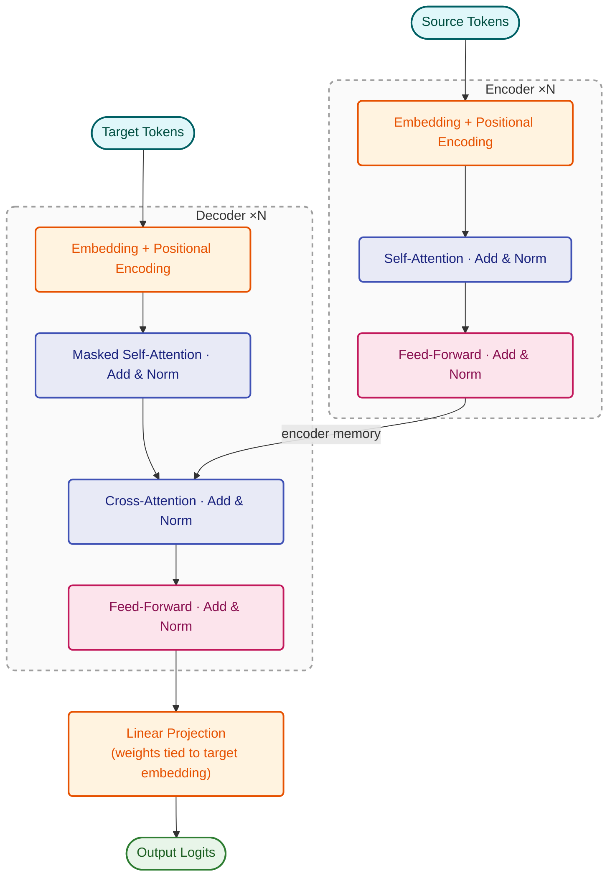

# Transformer (from-scratch Implementation)

A from-scratch PyTorch implementation of the Transformer architecture (_Attention Is All You Need_, Vaswani et al. 2017), trained on the [findnitai/english-to-hinglish](https://huggingface.co/datasets/findnitai/english-to-hinglish) dataset for English → Hinglish (romanised Hindi) translation.

---

## Project Structure

```
transformer/
├── configs/
│   ├── data_config.yaml      # dataset, tokenizer, and eval settings
│   ├── model_config.yaml     # model architecture hyperparameters
│   └── train_config.yaml     # training hyperparameters
│
├── data/
│   └── hinglish/
│       └── en_hinglish.tsv   # tab-separated EN↔Hinglish sentence pairs
│
├── scripts/
│   ├── download_data.py      # downloads the EN-Hinglish dataset from HuggingFace
│   ├── train.py              # main training script
│   ├── train_toy.py          # minimal toy example (5 sentence pairs)
│   └── predict.py            # CLI inference script
│
├── src/
│   ├── data/
│   │   ├── dataset.py        # TranslationDataset (PyTorch Dataset)
│   │   ├── dataloader.py     # collate_fn with padding
│   │   ├── tokenizer.py      # SentencePiece BPE tokenizer wrapper
│   │   └── vocab.py          # simple whitespace vocabulary (fallback)
│   │
│   ├── model/
│   │   ├── transformer.py    # top-level Transformer module
│   │   ├── encoder.py        # TransformerEncoder + EncoderLayer
│   │   ├── decoder.py        # TransformerDecoder + DecoderLayer
│   │   ├── masks.py          # padding mask and causal mask helpers
│   │   └── layers/
│   │       ├── attention.py          # ScaledDotProductAttention
│   │       ├── multihead_attention.py
│   │       ├── feed_forward.py       # PositionwiseFeedForward
│   │       ├── positional_encoding.py
│   │       ├── embeddings.py         # TokenEmbedding (scaled)
│   │       └── layer_norm.py         # custom LayerNorm
│   │
│   ├── inference/
│   │   ├── greedy_decode.py   # autoregressive greedy decoding
│   │   └── beam_search.py     # beam search decoding
│   │
│   ├── training/
│   │   ├── trainer.py         # single epoch training loop
│   │   ├── scheduler.py       # Transformer LR schedule (warmup + decay)
│   │   ├── checkpoint.py      # save / load checkpoints
│   │   └── metrics.py         # token-level accuracy helper
│   │
│   └── utils/
│       ├── config.py          # YAML config loader
│       └── seed.py            # global random seed setter
│
├── tokenizers/                # saved SentencePiece model files (generated)
├── checkpoints/               # saved model checkpoints (generated)
├── tests/                     # unit tests
├── pyproject.toml             # project dependencies (uv)
├── uv.lock                    # locked dependency versions (uv)
└── requirements.txt           # plain pip dependency list
```

---

## Architecture

The model follows the original Transformer architecture exactly:



**Key implementation details:**

- **Weight tying** — the output projection layer shares weights with the target token embedding, reducing parameters and improving training stability. When source and target share a vocabulary, the encoder embedding is tied as well.
- **Scaled embeddings** — token embeddings are initialised with `std = 1/√embed_dim` and multiplied by `√embed_dim` before positional encoding is added, so they start on the same scale as the positional encoding.
- **Custom LayerNorm** — implemented from scratch (pre-norm not used; post-norm as in the original paper).
- **Causal mask** — a lower-triangular boolean mask prevents the decoder from attending to future positions.

---

## Setup

```bash
git clone https://github.com/vinayak-ktp/transformer.git
cd transformer
uv sync --extra cpu               # or --extra cu121 for an NVIDIA GPU (CUDA 12.1)
uv run scripts/download_data.py   # downloads data/hinglish/en_hinglish.tsv (~189K EN<>Hinglish pairs)
```

Dependencies are managed with [uv](https://docs.astral.sh/uv/) via `pyproject.toml` and `uv.lock`. PyTorch is pulled from the matching PyTorch wheel index through the `cpu` / `cu121` extras (only one can be installed at a time).

**Requirements:** `torch`, `sentencepiece`, `sacrebleu`, `datasets`, `numpy`, `pyyaml`, `tqdm`, `pytest`

> `scripts/train.py` also calls the download automatically if the file is missing, so this step is optional.

---

## Configuration

All hyperparameters are controlled via three YAML files. Edit these before training.

### `configs/data_config.yaml`

```yaml
data_path: data/hinglish/en_hinglish.tsv # path to the tab-separated dataset
max_pairs: 189102 # number of pairs to load from file
max_src_len: 50 # max tokenised source length (filter)
max_tgt_len: 50 # max tokenised target length (filter)
val_ratio: 0.1 # fraction of data held out for validation

tokenizer: sentencepiece
tokenizer_model_type: bpe
tokenizer_vocab_size: 8000 # BPE vocabulary size
tokenizer_prefix: tokenizers/hinglish_shared_8k # where to save/load the tokenizer

bleu_eval_samples: 1000 # val sentences decoded per epoch for BLEU / chrF
```

### `configs/model_config.yaml`

```yaml
embed_dim: 384 # embedding / model dimension
num_heads: 6 # attention heads (must divide embed_dim)
hidden_dim: 1536 # feed-forward inner dimension (typically 4× embed_dim)
num_layers: 4 # number of encoder and decoder layers
dropout: 0.2
max_len: 5000 # maximum positional encoding length
```

### `configs/train_config.yaml`

```yaml
batch_size: 64
epochs: 30
warmup_steps: 4000 # LR warmup steps
scheduler_factor: 1.0 # scales the peak LR

label_smoothing: 0.1
gradient_clip: 1.0
weight_decay: 0.01 # not applied to LayerNorm params, biases or embeddings

save_every: 5 # save a periodic checkpoint every N epochs
seed: 42
device: cuda # falls back to cpu automatically if CUDA unavailable
```

> **Warmup tip:** `warmup_steps` should be proportional to dataset size. For ~150K training pairs at batch_size=64, ~2,400 steps/epoch — so `warmup_steps: 4000` means peak LR is reached in under 2 epochs. Scale it down if you train on a smaller subset (`max_pairs`).

---

## Training

Run from the project root:

```bash
uv run scripts/train.py
```

The script will:

1. Load and filter the dataset from `data_config.yaml`
2. Train (or load) a shared BPE tokenizer and save it to `tokenizers/`
3. Train the model, printing a per-epoch table of train loss, val loss, corpus BLEU and chrF (val loss is computed without label smoothing, so `exp(val_loss)` is the true perplexity)
4. Save a checkpoint to `checkpoints/best.pt` whenever BLEU improves
5. Save periodic checkpoints (e.g. `checkpoints/epoch_10.pt`) every `save_every` epochs
6. Print sample translations from the best checkpoint at the end

**Example output:**

```
Using device: cpu

Loading up to 189,102 pairs from data/hinglish/en_hinglish.tsv …
  Loaded … pairs
  After deduplication: … unique pairs
Found existing tokenizer at tokenizers/hinglish_shared.model, loading …
  Tokenizer vocab size: …
Filtering pairs to max_src=50, max_tgt=50 …
  Retained … pairs after filtering
  Train: …  |  Val: …

Model parameters: …

──────────────────────────────────────────────────────────────────────
 Epoch  Train Loss   Val Loss     BLEU     chrF
──────────────────────────────────────────────────────────────────────
   ...
```

### Toy training (smoke test)

A minimal script that trains on 5 hard-coded sentence pairs — useful for quickly verifying the pipeline works end-to-end:

```bash
uv run scripts/train_toy.py
```

### Test the architecture

Testing all the components and the full Transformer architecture:

```bash
uv run pytest tests
```

---

## Inference

### Single sentence

```bash
uv run scripts/predict.py "How are you?"
```

### Beam search decoding

```bash
uv run scripts/predict.py "How are you?" --mode beam --beam-width 4
```

### Specific checkpoint

```bash
uv run scripts/predict.py "I love you." --checkpoint epoch_20
```

Checkpoints are resolved as `checkpoints/<name>.pt` automatically — no path or extension needed.

### Interactive mode

Omit the sentence argument to enter a REPL:

```bash
uv run scripts/predict.py

# Interactive mode — type a sentence and press Enter. Type 'exit' to quit.
#
# EN > How are you?
# HG > aap kaise ho?
#
# EN > exit
# Exiting.
```

**All CLI options:**

| Flag           | Default  | Description                                      |
| -------------- | -------- | ------------------------------------------------ |
| `sentence`     | _(none)_ | Sentence to translate; omit for interactive mode |
| `--checkpoint` | `best`   | Checkpoint name under `checkpoints/`             |
| `--mode`       | `greedy` | Decoding strategy: `greedy` or `beam`            |
| `--beam-width` | `4`      | Beam width (only used with `--mode beam`)        |
| `--max-len`    | `50`     | Maximum output sequence length                   |

---

## How the Code Flows

### Training

```
train.py
  └── load_pairs()              reads en_hinglish.tsv, tab-splits into EN / Hinglish lists
  └── deduplicate_pairs()       keeps one Hinglish translation per English sentence
  └── filter_by_length()        drops pairs longer than max_src/tgt_len tokens
  └── train_val_split()         random 90/10 split
  └── train_sentencepiece_tokenizer()   trains shared BPE model on all sentences
  └── TranslationDataset        encodes pairs; wraps target with <SOS>…<EOS>
  └── DataLoader + collate_fn   pads variable-length sequences to batch max
  └── Transformer(...)          builds the model
  └── TransformerLRScheduler    warmup then inverse-sqrt decay
  └── [epoch loop]
        └── train_one_epoch()   teacher-forcing forward pass → CrossEntropy loss → backprop
        └── compute_val_loss()  same forward pass, no gradients, no label smoothing
        └── compute_metrics()   greedy-decode 1000 val samples → sacrebleu corpus BLEU + chrF
        └── save_checkpoint()   saves best BLEU and periodic checkpoints
```

### Inference (greedy)

```
greedy_decode(model, src, sos_idx, eos_idx, max_len, device)
  └── encoder.forward(src, src_mask)   → memory  (one pass, cached)
  └── [loop until <EOS> or max_len]
        └── decoder.forward(ys, memory, tgt_mask)
        └── fc(out)                    → logits
        └── argmax(logits[:, -1, :])   → next token
        └── append to ys
  └── return ys (token ID sequence)
```

### Inference (beam search)

Same encoder pass, but the loop maintains the top-K candidate sequences ranked by length-normalised log-probability (`score / len ** length_penalty`, default `0.6`), expanding each by `beam_width` tokens per step.

---

## Tests

```bash
uv run pytest tests
```

Tests cover masks, attention, encoder/decoder shapes, the LR scheduler, and tokenizer behaviour.

---

## Improving Translation Quality

| Change                                                | Impact             | Config key          |
| ----------------------------------------------------- | ------------------ | ------------------- |
| Train more epochs                                     | High               | `epochs`            |
| Reduce `warmup_steps` to match dataset size           | High               | `warmup_steps`      |
| Use more data (`max_pairs`)                           | High               | `max_pairs`         |
| Increase model size (`embed_dim`, `num_layers`)       | Medium (needs GPU) | `model_config.yaml` |
| Use beam search at inference                          | Low–Medium         | `--mode beam`       |
| Track chrF over BLEU for noisy romanised targets      | Metric only        | —                   |
| Allow longer sentences (`max_src_len`, `max_tgt_len`) | Medium             | `data_config.yaml`  |
